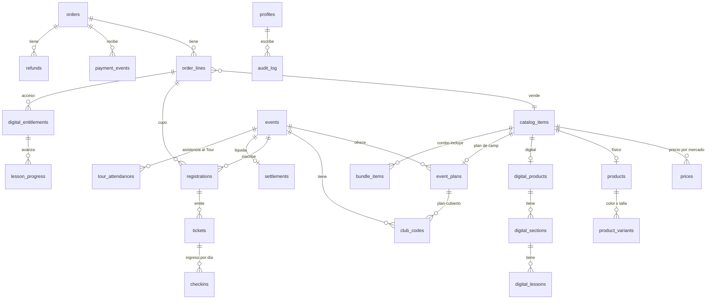

# Modelo de datos — VolleyTip.com

Base de datos Postgres en Supabase. Fuente: `docs/SRD-volleytip-web-v1.4.md`. Plan: `docs/plan-maestro.md`.
Fecha: 11 de noviembre de 2026.

Este documento define las tablas, sus campos principales, las reglas que la base de datos debe garantizar y quién puede leer o escribir cada cosa. El detalle fino (índices secundarios, nombres exactos de políticas) lo fija el PRD de cada epic; lo que aquí está escrito no se cambia sin actualizar este documento.

## 1. Convenciones

| Tema | Regla |
| --- | --- |
| Nombres | Tablas y columnas en inglés, `snake_case`, tablas en plural |
| Identificadores | `id uuid` con `gen_random_uuid()`. Los números visibles (pedido `VT-1042`) son columnas aparte |
| Fechas | `timestamptz` en UTC. Toda tabla tiene `created_at`; las editables, `updated_at` |
| Dinero | `bigint` en la unidad menor de la moneda más `currency char(3)` (DR-001). Los pesos se guardan en centavos: `$120.000` es `12000000`. Un `integer` llegaría solo a unos 21 millones de pesos. Nunca `numeric` ni `float` para montos |
| Correo | Guardado normalizado: minúsculas y sin espacios (DR-008). Tipo `citext` |
| Borrado | No se borran pedidos, inscripciones, accesos ni facturas: se usa `status` (DR-006) |
| Traducciones | Tabla base + tabla `<base>_translations` con `locale` y los campos de texto. Clave única (`<base>_id`, `locale`). El español es obligatorio |
| RLS | Activado en todas las tablas. Sin política = sin acceso desde el navegador. El servidor usa `service_role` solo dentro de funciones concretas |
| Ámbito | El comentario de cada tabla empieza con `scope: shared` (la comparte la app) o `scope: web` (solo la web), y declara uno solo (FR-076). Una prueba revisa el catálogo y falla si una tabla de `public` no tiene RLS o no declara su ámbito (`src/db/catalog-review.ts`) |
| Estados | Tipos `enum` de Postgres, listados en la sección 3 |
| Auditoría | Toda acción del admin escribe en `audit_log` (FR-067) |

## 2. Mapa general

**La idea central: `catalog_items`.** Todo lo que se puede vender (un producto físico, un producto digital, un plan de camp o un combo) es una fila de `catalog_items`. El carrito, los precios por mercado y las líneas de pedido apuntan ahí. Así el carrito único (FR-095), los precios por mercado (FR-010) y los combos (FR-094) se resuelven una sola vez y no tres.

## 3. Tipos enumerados

| Enum | Valores |
| --- | --- |
| `user_role` | `admin`, `staff`, `buyer` |
| `item_kind` | `physical`, `digital`, `event_plan`, `bundle` |
| `publish_status` | `draft`, `published`, `retired` |
| `price_mode` | `manual` (la fase 3 agrega `auto`, FR-010) |
| `tip_fundamental` | `serve`, `reception`, `setting`, `attack`, `block`, `defense` (saque, recepción, colocación, ataque, bloqueo, defensa) |
| `tip_level` | `basic`, `intermediate`, `advanced` (básico, intermedio, avanzado) |
| `tip_orientation` | `vertical`, `horizontal` |
| `payment_status` | `pending`, `paid`, `failed`, `expired`, `cancelled`, `partially_refunded`, `refunded` |
| `fulfillment_status` | `to_ship`, `shipped` (la fase 2 agrega `preparing` y `delivered`) |
| `payment_method` | `card`, `pse`, `nequi`, `bancolombia_button`, `club_code`, `none` |
| `refund_status` | `requested`, `money_returned`, `cancelled` |
| `invoice_status` | `not_required`, `pending`, `issued`, `failed`, `credited` |
| `event_type` | `camp`, `tour` |
| `registration_status` | `pending`, `confirmed`, `transferred`, `cancelled`, `refunded` |
| `ticket_status` | `valid`, `void` |
| `entitlement_source` | `purchase`, `bundle`, `manual` |
| `entitlement_status` | `active`, `revoked` |
| `attendance_mode` | `individual`, `group` |
| `attendance_status` | `confirmed`, `pending_review`, `cancelled`, `deleted` |
| `message_status` | `new`, `answered`, `archived` |
| `settlement_status` | `open`, `pending_payment`, `paid` |
| `email_status` | `queued`, `sent`, `failed` |

## 4. Configuración y cuentas (W1, W2, W10a)

### `profiles`
Un perfil por usuario de Supabase Auth (FR-077). El de comprador se crea solo, sin contraseña, al pagar o al entrar a "Mis compras".

| Columna | Tipo | Notas |
| --- | --- | --- |
| `id` | uuid PK | Igual a `auth.users.id` |
| `email` | citext, único | Normalizado |
| `role` | `user_role` | `buyer` por defecto |
| `full_name` | text | |
| `locale` | text | `es` o `en` |
| `is_active` | boolean | Los admin y staff se pueden desactivar |

### `languages`
`code` (PK, `es`, `en`), `name`, `is_default`, `is_active`. Agregar `pt` es agregar una fila (FR-004). La base no deja desactivar el idioma por defecto.

### `markets`
`id`, `country_code` (ISO), `currency`, `default_locale`, `ships_physical` (boolean), `payment_methods` (text[]), `is_active`. En la fase 1 solo Colombia está activo (FR-009). La base exige al menos un mercado activo (también con escrituras simultáneas), que `default_locale` se elija entre los idiomas activos y que `payment_methods` salga de `card`, `pse`, `nequi` y `bancolombia_button`.

### `shipping_zones`
`id`, `market_id`, `name`, `matcher` (jsonb: lista de departamentos o ciudades; una zona con `matcher` vacío es "resto del país"), `fee` + `currency`, `eta_min_days`, `eta_max_days`, `sort_order` (FR-120).

### `settings`
`key` (PK text), `value` (jsonb), `updated_by`. Claves iniciales: `free_shipping_threshold`, `annual_cap` (FR-129), `invoicing_enabled` (FR-127), `maintenance_mode` (FR-056), `tour_counter_public` (FR-134), `announcement_bar`, `usd_reference_rate` (tasa manual para el precio aproximado, FR-122), `app_availability` (FR-054: `{"status":"waitlist"}` o `{"status":"available","appStoreUrl":"https://apps.apple.com/...","playStoreUrl":"https://play.google.com/..."}`; sin fila, la página de la app está en lista de espera), `app_links` (FR-080, FR-081: los identificadores con que el celular abre `/r/<código>` en la app; `{"android":{"packageName":"com.volleytip.app","sha256CertFingerprints":["AA:BB:..."]},"ios":{"appIds":["TEAMID.com.volleytip.app"]}}`, cada plataforma es opcional y las listas no van vacías; alimenta `/.well-known/assetlinks.json` y `/.well-known/apple-app-site-association`; sin fila o con una forma inválida los dos archivos salen vacíos)

### `site_texts`
`key`, `locale`, `value`. Clave única (`key`, `locale`). Textos editables sin código (FR-065). Los textos fijos de la interfaz viven en archivos de traducción, no aquí.

### `audit_log`
`id`, `actor_id` (profiles), `action` (text, por ejemplo `order.refund`), `entity` (text), `entity_id` (uuid), `details` (jsonb), `created_at`. Solo inserción; nadie la edita ni la borra. Índices por (`created_at`, `id`), solo y precedido por `actor_id` o por `action`, para la pantalla de bitácora. Sus filtros leen `audit_log_actors()` y `audit_log_actions()`, que corren con los permisos de quien consulta.

### `rate_limits` y `form_rejections`
- `rate_limits`: `key` (texto: formulario + hash de IP), `window_start`, `expires_at` (final de la ventana, fijo desde que empieza), `count`. Solo la escribe `check_rate_limit`. Una tarea diaria borra las que vencieron hace más de un día.
- `form_rejections`: `form`, `reason` (`turnstile`, `honeypot`, `too_fast`, `rate_limit`, `validation`), `day`, `count`. Solo contadores, sin contenido (FR-135).

La IP nunca se guarda en claro: se guarda un hash con sal que rota cada día.

## 5. Contenido (W4)

### `tips` y `tip_translations`
`tips`: `id`, `slug` (único; minúsculas, números y guiones), `bunny_video_id` (único: un video de Bunny pertenece como máximo a un tip), `orientation` (`tip_orientation`), `duration_seconds` (mayor que cero), `thumbnail_url`, `fundamental` (`tip_fundamental`), `level` (`tip_level`), `tiktok_url`, `promo` (jsonb, `{"type":"app"}` o `{"type":"social"}`; nulo muestra las redes, FR-014), `is_featured` (uno solo a la vez), `status` (`publish_status`), `published_at` (una fecha futura lo deja programado).

Fundamento y nivel son listas fijas de la base: agregar un valor pide una migración. Sus nombres visibles salen de los archivos de traducción. Un borrador puede no tener video, datos del video, fundamento ni nivel. La base no deja publicar sin `bunny_video_id`, `orientation`, `duration_seconds`, `thumbnail_url`, `fundamental`, `level` y `published_at`. Un tip no se borra: ningún rol de la API tiene ese permiso. El paquete digital relacionado (FR-106) lo agrega W14.

`tip_translations`: `tip_id`, `locale`, `title` (obligatorio), `achievement`, `keys` (text[] de hasta 3, sin claves en blanco), `common_error`, `practice`. Clave única (`tip_id`, `locale`). Un admin puede quitar la traducción de un idioma.

Vista `public_tips`: solo publicados cuya fecha ya pasó. Columnas: `id`, `slug`, `bunny_video_id`, `orientation`, `duration_seconds`, `thumbnail_url`, `fundamental`, `level`, `tiktok_url`, `promo`, `is_featured`, `published_at` y `translations` (objeto por idioma con `title`, `achievement`, `keys`, `common_error`, `practice`). Consulta con los permisos de quien la lee (`security_invoker`). Es lo que leerá la app (FR-078, AC-034): cambiar sus columnas la puede romper.

La función `search_public_tips(p_locale, p_query, p_fundamental, p_level)` devuelve filas de esa vista para el listado (FR-013). Busca en el título, la frase de logro y las claves del idioma pedido, con español en los campos que falten, sin distinguir mayúsculas ni tildes (extensión `unaccent`). Omite los tips sin español.

Las vistas se cuentan por tip y por día en una tabla propia, con una función atómica que suma una; reemplaza a la columna `views_week` que este documento traía. No guarda IP ni identificadores. La define el PRD de W4 (`docs/prd/w4-tips.md`, RF-6).

## 6. Catálogo (W5, W8, W14)

### `catalog_items`
| Columna | Tipo | Notas |
| --- | --- | --- |
| `id` | uuid PK | |
| `kind` | `item_kind` | |
| `status` | `publish_status` | |
| `tax_rate_bp` | integer | Tarifa de IVA en puntos básicos, de 0 a 10000; nace en 0 y en la fase 1 se queda ahí (FR-126) |
| `counts_for_free_shipping` | boolean | Verdadero solo en físicos (AC-006) |

### `prices`
`catalog_item_id`, `market_id`, `amount` (**`bigint`**, en la unidad menor, `check (amount >= 0)`), `currency`, `mode` (`price_mode`). Clave primaria (`catalog_item_id`, `market_id`). La moneda es la del mercado: una llave foránea compuesta (`market_id`, `currency`) a `markets` lo garantiza y impide cambiar la moneda de un mercado con precios. Al borrar el ítem se borran sus precios. Un precio es público solo si su ítem está publicado y su mercado activo. El precio base es el del mercado Colombia. En la fase 1 todos los precios se fijan a mano (FR-010).

### `bundle_items`
`bundle_id` (catalog_items de tipo `bundle`), `included_item_id`, `quantity`. Un combo "Camp + paquete" es un `catalog_item` propio con su precio y dos filas aquí (FR-094).

### Productos físicos
- `products`: `id`, `catalog_item_id` (único), `slug`, `category`, `audience`, `low_stock_threshold`, `is_new_until`.
- `product_translations`: `name`, `description`.
- `product_colors`: `id`, `product_id`, `name`, `hex`, `sort_order`.
- `product_images`: `id`, `product_id`, `color_id` (nulo = todas), `url`, `alt`, `is_cover`, `sort_order`.
- `product_variants`: `id`, `product_id`, `color_id` (nulo en accesorios), `size` (nulo en accesorios), `sku`, `stock` (integer, **`check (stock >= 0)`**). Clave única (`product_id`, `color_id`, `size`).
- `product_relations`: `product_id`, `related_product_id`, `sort_order` (FR-021).
- `restock_alerts`: `variant_id`, `email`, `locale`, `notified_at` (FR-020). Se avisa una sola vez.

### Productos digitales
- `digital_products`: `id`, `catalog_item_id` (único), `slug`, `type` (`pack`, `download`), `cover_url`, `intro_bunny_video_id`, `level`, `version` (sube al actualizar el paquete, FR-091).
- `digital_product_translations`: `title`, `summary`, `what_you_learn`, `audience_text`, `faq` (jsonb).
- `digital_sections` y `digital_section_translations`: `product_id`, `sort_order`; `title`.
- `digital_lessons` y `digital_lesson_translations`: `section_id`, `bunny_video_id`, `duration_seconds`, `is_preview` (muestra gratis, FR-084), `sort_order`; `title`, `guide` (texto de la guía).
- `digital_files`: `id`, `product_id`, `lesson_id` (nulo = del paquete), `storage_path` (ruta privada en Bunny Storage, nunca una URL pública), `filename`, `size_bytes`, `mime`, `watermark` (boolean, FR-089).

## 7. Compra (W6a, W6b, W10b)

### `carts`
El carrito vive en el navegador 30 días. Esta tabla solo guarda una copia cuando la persona escribe su correo en el checkout y marca la casilla del recordatorio (FR-102).
`id`, `email`, `locale`, `items` (jsonb), `reminder_consent_at`, `reminder_sent_at`, `unsubscribed_at`, `converted_order_id`.

### `orders`
| Columna | Tipo | Notas |
| --- | --- | --- |
| `id` | uuid PK | |
| `number` | integer, único | De una secuencia que empieza en 1001; se muestra `VT-1042` (DR-003) |
| `email` | citext | Llave de la compra |
| `buyer_id` | uuid, nulo | `profiles.id` cuando existe |
| `payment_status` | `payment_status` | |
| `fulfillment_status` | `fulfillment_status`, nulo | Nulo si el pedido no tiene productos físicos; `to_ship` al quedar pagado (FR-029) |
| `market_id`, `currency`, `locale` | | Congelados al comprar (FR-011) |
| `subtotal`, `shipping_fee`, `discount`, `tax_total`, `total` | bigint | |
| `billing_name`, `billing_doc_type`, `billing_doc_number` | text | Documento opcional en la fase 1 (FR-125) |
| `whatsapp` | text | |
| `shipping_address` | jsonb, nulo | Departamento, ciudad, dirección; nulo si no hay físicos |
| `shipping_zone_id`, `carrier`, `tracking_number`, `shipped_at` | | (FR-120) |
| `payment_method` | `payment_method` | |
| `wompi_transaction_id`, `wompi_reference` | text | La referencia es única (FR-115) |
| `wompi_transaction_status` | text, nulo | Lo último que reportó Wompi. Mientras sea pendiente, el pedido no expira (FR-029) |
| `access_token` | text, único | Para el enlace privado "Mi pedido", que también muestra "Estamos confirmando tu pago" (FR-044, DR-004) |
| `terms_version` | text | Versión de términos aceptada (FR-057) |
| `expires_at` | timestamptz | 30 minutos después de crearlo. Solo vence si no hay un pago pendiente en Wompi (FR-029) |
| `paid_at` | timestamptz | |
| `needs_attention` | boolean | Pago tardío sin stock, entre otros (FR-029) |

### `order_lines`
`id`, `order_id`, `catalog_item_id`, `kind` (`item_kind`, copiado), `variant_id` (nulo salvo físicos), `title_snapshot`, `detail_snapshot` (color y talla, plan, etc.), `quantity`, `unit_price`, `unit_base`, `tax_rate_bp`, `unit_tax`, `discount`, `club_code_id` (nulo; el código de club se aplica por línea, FR-097), `line_total`, `currency`, `parent_line_id` (para los ítems incluidos en un combo), `refunded_quantity`. Guarda nombre y valores tal como eran al comprar (DR-009, AC-004).

### `reservations`
`id`, `order_id`, uno de `variant_id`, `event_id` o `club_code_id`, `quantity`, `expires_at`, `released_at`. Es el único sitio donde se retiene algo sin pagar: el stock, los cupos y los cupos de código de club disponibles son el total menos lo vendido menos las reservas vigentes (FR-099). Un cupo pagado con código de club lleva dos reservas: la del evento y la del código. Una tarea programada libera las vencidas cada minuto, salvo las de pedidos con pago pendiente en Wompi (FR-029).

### `payment_events`
`id`, `provider` (`wompi`), `event_id` (**único**, para idempotencia, DR-005), `order_id`, `type`, `status`, `payload` (jsonb), `signature_valid` (boolean), `received_at`, `processed_at`. Un evento con firma inválida se guarda con `signature_valid = false` y no se procesa (AC-008).

### `refunds` y `refund_lines`
- `refunds`: `id`, `order_id`, `status` (`refund_status`), `reason` (obligatorio), `amount`, `currency`, `fee_absorbed_by` (`volleytip`, `buyer`; pendiente P-10), `method` (`wompi_void`, `bank_transfer`, `nequi`), `proof_reference`, `proof_file_path`, `created_by`, `money_returned_at`. No se puede pasar a `money_returned` sin referencia o comprobante (AC-053).
- `refund_lines`: `refund_id`, `order_line_id`, `quantity`, `amount`, `base`, `tax`, `restock` (boolean: devuelve inventario si el producto regresó).

### `invoices`
`id`, `order_id`, `refund_id` (nulo; lleno si es nota crédito), `status` (`invoice_status`), `provider`, `number`, `cufe`, `pdf_url`, `attempts`, `last_error`. En la fase 1 no se crean filas: el interruptor está apagado (FR-127).

## 8. Camps (W8, W9)

### `clubs`
`id`, `name`, `contact_name`, `contact_email`, `contact_phone`, `bank_details` (jsonb, solo admin), `notes`.

### `events` y `event_translations`
Sirve para camps y para paradas del VBall Tour (FR-116, FR-130).

| Columna | Tipo | Notas |
| --- | --- | --- |
| `id`, `slug` | | |
| `type` | `event_type` | `camp` o `tour` |
| `status` | `publish_status` | |
| `starts_on`, `ends_on` | date | Un camp dura 2 días |
| `start_time` | time | |
| `venue_name`, `city`, `region`, `country_code`, `map_url` | | |
| `capacity` | integer, nulo | 150 por defecto en camps; opcional en el Tour |
| `club_id` | uuid, nulo | Club anfitrión |
| `club_share` + `currency` | integer | Parte del club por cupo vendido (FR-116) |
| `refund_until_days` | integer | 8 por defecto (FR-118) |
| `poster_url`, `gallery_id` | | |
| `partners` | jsonb | Aliados del Tour: nombre, logo, enlace, si recibe donaciones (FR-133) |

`event_translations`: `title`, `description`, `includes` (text[]), `agenda` (jsonb), `faq` (jsonb).

### `event_plans`
`id`, `event_id`, `catalog_item_id` (único), `includes_shirt` (boolean), `sort_order`; con `event_plan_translations` (`name`). El precio está en `prices`.

### `club_codes`
`id`, `event_id`, `club_id`, `plan_id` (el plan que cubre, de `event_plans`), `code` (único), `seats_bought`, `seats_used` (**`check (seats_used <= seats_bought)`**), `prepaid_seat_price` + `currency` (lo acordado con el club por cupo), `is_active` (FR-037, AC-013, AC-014, AC-043). El código solo deja en $0 un cupo de su plan.

### `registrations`
Una fila por cupo, es decir, por jugador (FR-038, FR-041).

| Columna | Tipo | Notas |
| --- | --- | --- |
| `id` | uuid PK | |
| `event_id`, `plan_id` | uuid | |
| `order_line_id` | uuid | La línea del pedido que la pagó |
| `club_code_id` | uuid, nulo | Si entró con código de club |
| `buyer_email` | citext | El del comprador |
| `player_name` | text | |
| `player_birthdate` | date | Define si es menor en la fecha del camp |
| `level` | text | |
| `shirt_size` | text, nulo | Solo si el plan incluye camiseta |
| `guardian_name`, `guardian_phone` | text, nulos | Obligatorios si es menor |
| `waiver_accepted_at`, `image_consent_at`, `consent_version` | | (FR-038, FR-057) |
| `status` | `registration_status` | `pending` hasta que el pedido se paga. Una inscripción `pending` no cuenta cupo: el cupo lo retiene `reservations` |
| `anonymized_at` | timestamptz | Retención de datos de menores (DR-007, P-11) |

### `tickets`
`id`, `registration_id`, `token` (único, aleatorio; es lo único que lleva el QR, FR-043), `token_hash` (lo que descarga el escáner sin conexión, nunca el token, FR-049), `status` (`ticket_status`), `voided_reason`. Al ceder un cupo, el tiquete anterior pasa a `void` y se crea uno nuevo.

### `ticket_transfers`
`id`, `from_registration_id`, `to_registration_id`, `to_email`, `created_at`, `requested_by_email`, `verified_by` (`email_code` o `session`) (FR-119).

### `checkins`
`id`, `ticket_id`, `event_day` (date), `checked_at`, `staff_link_id` o `staff_profile_id`, `shirt_delivered` (boolean), `synced_offline` (boolean). **Clave única (`ticket_id`, `event_day`)**: es lo que garantiza un ingreso por día (FR-048, AC-015).

### `staff_links`
`id`, `event_id`, `token` (único), `pin_hash`, `label` (quién lo usa), `valid_from`, `valid_until`, `is_active`, `failed_attempts`, `locked_until` (FR-046, FR-047).

### `settlements`
`id`, `event_id` (único), `seats_paid`, `seats_refunded`, `seats_counted`, `club_share`, `total`, `currency`, `status` (`settlement_status`), `paid_at`, `method`, `proof_reference`, `proof_file_path`, `closed_by`. Los valores se calculan desde `registrations` mientras está abierta y se congelan al marcarla pagada (FR-117, AC-054).

## 9. VBall Tour (W15)

Las paradas son filas de `events` con `type = 'tour'`: no tienen planes, ni cupos pagados, ni tiquetes.

### `tour_attendances`
| Columna | Tipo | Notas |
| --- | --- | --- |
| `id` | uuid PK | |
| `event_id` | uuid | La parada |
| `mode` | `attendance_mode` | |
| `name` | text | Quien se anota o el responsable del grupo |
| `whatsapp` | text | Normalizado a formato internacional |
| `email` | citext, nulo | |
| `institution` | text, nulo | Obligatorio en modo grupo |
| `adults`, `kids` | integer | `check (adults >= 0 and kids >= 0 and adults + kids > 0)` |
| `status` | `attendance_status` | |
| `review_reason` | text, nulo | `rate_limit` o `large_group` |
| `manage_token` | text, único | Enlace para cambiar el número o cancelar |
| `reminder_sent_at` | timestamptz | |

Reglas (FR-131, FR-136):
- **Clave única (`event_id`, `whatsapp`)** entre los registros no cancelados: repetir actualiza el anterior.
- En modo individual, `adults + kids <= 10`.
- No hay columnas para nombres ni edades de los niños.
- El contador público suma solo los `confirmed`.

Los aliados interesados no tienen tabla propia: son `messages` con motivo `vball_tour`.

## 10. Productos digitales: accesos (W14)

### `digital_entitlements`
Quién es dueño de qué. Es la tabla más sensible del lado digital.

| Columna | Tipo | Notas |
| --- | --- | --- |
| `id` | uuid PK | |
| `email` | citext | El dueño es el correo, exista o no un perfil |
| `digital_product_id` | uuid | |
| `source` | `entitlement_source` | |
| `order_line_id` | uuid, nulo | Nulo en accesos manuales |
| `status` | `entitlement_status` | |
| `granted_at`, `revoked_at`, `revoked_reason` | | (FR-092) |
| `granted_by` | uuid, nulo | Admin que dio el acceso manual |

Clave única (`email`, `digital_product_id`) entre los activos.

### `lesson_progress`
`entitlement_id`, `lesson_id`, `completed_at`, `position_seconds`, `updated_at`. Clave única (`entitlement_id`, `lesson_id`) (FR-087).

### `download_log`
`id`, `entitlement_id`, `file_id`, `created_at`. Sirve para el avance que ve el admin al reembolsar (FR-113) y para detectar uso anormal (FR-090).

### `buyer_sessions`
`id`, `profile_id`, `device_label`, `last_seen_at`, `revoked_at`. Permite limitar las sesiones simultáneas y "cerrar sesión en todos los dispositivos" (FR-090, FR-112).

Los códigos de 6 dígitos y los enlaces de un solo uso los maneja Supabase Auth; no se guardan en tablas propias. Los intentos fallidos se cuentan en `rate_limits`. Esto queda por confirmar (M-7 y M-8).

## 11. Mensajes, listas y correos (W3, W10a, W11a)

### `messages`
`id`, `reason` (`order`, `camps`, `brands`, `suggest_tip`, `vball_tour`, `other`), `name` (hasta 120), `email` (en minúsculas y sin espacios), `whatsapp`, `country_code` (nulo o dos letras mayúsculas), `body` (el mensaje, hasta 2.000 caracteres; fuera de `payload` para poder limitarlo y buscarlo), `payload` (jsonb, siempre un objeto, con los campos propios del motivo: número de pedido, organización, formas de participar…), `locale`, `privacy_version` (la versión de la política que aceptó la persona), `status` (`message_status`: `new`, `answered`, `archived`), `answered_by`, `answered_at`, `created_at` (FR-053, FR-064, FR-132). Se inserta con la función `save_message`; un admin lee y cambia solo `status`, `answered_by` y `answered_at`. No guarda la IP.

### `waitlists`
`id`, `kind` (`app`, `camp_notify`), `email` (en minúsculas y sin espacios), `locale`, `country_code`, `city`, `privacy_version` (la versión de la política que aceptó la persona), `notified_at`, `created_at`. Clave única (`kind`, `email`) (FR-035, FR-082). Se inscribe con la función `enroll_waitlist`, que no falla ni cambia nada si el correo ya estaba.

### `faqs` y `faq_translations`
`faqs`: `id`, `sort_order`, `status` (`publish_status`). `faq_translations`: `question`, `answer`. Página de preguntas frecuentes editable desde el admin (FR-137). El sitio y el panel las ordenan por `sort_order`, `created_at` e `id`. El panel escribe con las funciones `create_faq`, `save_faq`, `set_faq_status` y `move_faq`, que solo corren para un admin. Ellas impiden publicar sin el idioma por defecto (no es una restricción de la tabla; el sitio omite una pregunta sin español). Una sesión no puede borrar preguntas: se retiran.

### `email_log`
`id`, `template`, `to_email`, `locale`, `related_entity`, `related_id`, `status` (`email_status`), `provider_id`, `attempts`, `last_error`, `sent_at` (FR-069). W11a le suma los datos de la plantilla (para reintentar; se borran a los 90 días), la llave que evita envíos duplicados, cuándo toca el siguiente intento y los estados de entrega que reporta Resend.

### Conversación de un mensaje (W11a)

El PRD de W11a (`docs/prd/w11a-correos-base.md`) agrega: las plantillas de respuesta (nombre, idioma, asunto, cuerpo, orden y si está activa); las respuestas y contestaciones de cada mensaje, con su dirección (saliente o entrante), autor, texto y estado; los adjuntos de cada una, guardados en un bucket privado de Supabase Storage; la dirección de respuesta única de cada mensaje; los avisos de Resend ya procesados; y las bajas de los correos de marketing. Una contestación devuelve el mensaje a `new`. Los nombres exactos de tablas y columnas los fija cada ticket y este documento se actualiza con ellos.

### Fase 2
`galleries` y `gallery_items` quedan definidas en el PRD de W12.

## 12. Funciones de base de datos

Las operaciones que no admiten carrera son funciones de Postgres. Cada una corre en una transacción, bloquea las filas que toca y la aplicación no las reemplaza con "leer y luego escribir".

| Función | Qué hace | Requisitos |
| --- | --- | --- |
| `create_pending_order(cart, buyer, shipping)` | Recalcula precios en el servidor, valida stock, cupos y códigos de club (que el código cubra el plan y le queden cupos), crea el pedido pendiente con sus líneas, sus inscripciones `pending` y sus reservas de 30 minutos, y devuelve la referencia. Si algo ya no está disponible, devuelve qué ítem y no crea nada | FR-025, FR-099, AC-005, AC-011, AC-043, AC-044 |
| `confirm_order_paid(payment_event_id)` | Solo desde el webhook verificado. Marca pagado, descuenta stock, convierte las reservas en ventas, confirma inscripciones y emite tiquetes, crea accesos digitales, suma `seats_used` del código y encola los correos. Repetirla con el mismo evento no hace nada | FR-026, FR-027, FR-100, AC-007 |
| `confirm_free_order(order_id)` | Lo mismo para un pedido en $0 por código de club, sin pasar por Wompi | FR-039, AC-043 |
| `expire_pending_orders()` | Tarea por minuto: pasa a `expired` lo vencido sin pago iniciado y libera sus reservas. No toca los pedidos cuya transacción Wompi reporta como pendiente | FR-029, AC-009, AC-012 |
| `handle_late_payment(order_id)` | Pago aprobado después de expirar: reactiva si aún hay stock y cupos; si no, marca `needs_attention` | FR-029 |
| `refund_order_lines(order_id, lines, reason)` | Crea el reembolso, revoca accesos, anula tiquetes, libera cupos y devuelve inventario si aplica. No mueve dinero | FR-113, AC-052 |
| `change_order_email(order_id, new_email, verification)` | Pasa pedido, accesos y tiquetes al correo nuevo, invalida enlaces y sesiones del anterior, y escribe en la bitácora | FR-109, AC-048 |
| `checkin_ticket(token, event_day, staff)` | Devuelve `valid` (con nombre del jugador, plan y talla de camiseta), `already_in` (con hora y staff) o `invalid`. La clave única de `checkins` impide el doble ingreso | FR-048, AC-015 |
| `search_checkin(event_id, query, staff)` | Busca por nombre del jugador o WhatsApp del comprador. Devuelve nombre del jugador, plan, nombre del comprador y los últimos 4 dígitos de su WhatsApp | FR-049, AC-066 |
| `transfer_ticket(ticket_token, new_player, verification)` | Exige la prueba de que quien cede es el comprador (código enviado a su correo o sesión de "Mis compras"). Anula el tiquete, crea la inscripción y el tiquete nuevos, y registra la cesión. Rechaza si es el día del camp o después | FR-119, AC-056 |
| `register_tour_attendance(event_id, data, flags)` | Inserta o actualiza por WhatsApp, aplica los topes y decide `confirmed` o `pending_review` | FR-131, FR-136, AC-060, AC-064 |
| `grant_entitlement` / `revoke_entitlement` | Acceso manual y revocación, con bitácora | FR-092, AC-040 |

Los precios, el código de club y el envío **siempre se recalculan en el servidor** dentro de `create_pending_order`. Lo que manda el navegador solo dice qué ítems y cuántos.

## 13. Quién puede leer y escribir (RLS)

| Grupo de tablas | Sin sesión | Comprador (su sesión) | Staff | Admin |
| --- | --- | --- | --- | --- |
| Contenido publicado: tips, productos, digitales (solo lo público y las lecciones de muestra), eventos, planes, precios, zonas, textos, preguntas frecuentes, idiomas, mercados | Leer lo publicado | Igual | Igual | Todo |
| `product_variants` | Leer disponibilidad (sin costo ni SKU interno) | Igual | Igual | Todo |
| `orders`, `order_lines`, `refunds` | Nada. "Mi pedido" se sirve desde el servidor con `access_token` | Leer los suyos (por correo) | Nada | Todo |
| `registrations`, `tickets` | Nada. "Mi tiquete" se sirve desde el servidor con el token | Leer los suyos | Solo por las funciones del escáner de su evento | Todo |
| `checkins` | Nada | Leer los de sus tiquetes | Insertar por `checkin_ticket` | Todo |
| `digital_entitlements`, `lesson_progress`, `download_log` | Nada | Leer los suyos; escribir su avance | Nada | Todo |
| `digital_lessons` (no muestra), `digital_files` | Nada | Solo si tiene acceso activo al producto | Nada | Todo |
| `tour_attendances`, `messages`, `waitlists`, `carts` | Insertar solo por las funciones del servidor | Nada | Nada | Todo |
| `clubs`, `club_codes`, `settlements`, `staff_links` | Nada (los códigos se validan en el servidor) | Nada | Nada | Todo |
| `payment_events`, `invoices`, `email_log`, `audit_log`, `settings`, `rate_limits`, `form_rejections` | Nada | Nada | Nada | Leer; escribir solo `settings` |
| `profiles` | Nada | Leer y editar el suyo, sin cambiar `role` | Leer el suyo | Todo |

Reglas que el PRD de cada epic debe probar:

- Un comprador nunca lee filas de otro correo (AC-049 y siguientes).
- Los datos de jugadores menores solo los ve el admin; el staff solo recibe lo que devuelven `checkin_ticket` y `search_checkin` (nombre del jugador, plan, talla, nombre del comprador y últimos 4 dígitos de su WhatsApp), nunca fecha de nacimiento, si es menor ni datos del acudiente (NFR-004, FR-048).
- El rol `buyer` no obtiene acceso con ninguna política del admin (AC-033).
- Los videos y archivos de pago no se sirven por RLS sino por URLs firmadas que el servidor genera después de comprobar el acceso (FR-088).

## 14. Tareas programadas

| Tarea | Frecuencia | Qué hace |
| --- | --- | --- |
| Vencer pedidos y liberar reservas | Cada minuto | `expire_pending_orders()`. No vence pedidos con pago pendiente en Wompi |
| Conciliar con Wompi | Diaria | Compara pedidos pendientes y pagados contra la API de Wompi (RSK-002) |
| Recordatorio de carrito | Cada hora | Un correo a las 24 horas, una sola vez (FR-102) |
| Recordatorio de camp | Diaria, 6 p. m. | A los inscritos del camp del día siguiente (FR-068) |
| Recordatorio del Tour | Diaria | A los registros confirmados de la parada del día siguiente (FR-131) |
| Alerta de registros del Tour | Cada 10 minutos | Más de 30 registros en una hora en una parada (FR-136) |
| Aviso de tope anual | Diaria | 70% y 90% de `annual_cap` (FR-129) |
| Limpieza | Diaria | `rate_limits` vencidos; anonimizar datos de menores pasado el plazo (DR-007) |
| Reintento de correos | Cada 10 minutos | Los `failed` con menos de 5 intentos (FR-069) |

## 15. Orden de las migraciones

Cada epic crea solo sus tablas. Las migraciones van en un solo carril a la vez (ver el plan maestro).

| Epic | Crea |
| --- | --- |
| W1 | `profiles`, `settings`, `audit_log`, `rate_limits`, `form_rejections`, todos los enums base |
| W2 | `languages`, `markets`, `site_texts`, `catalog_items`, `prices` |
| W3 | `messages`, `waitlists`, `faqs`, `faq_translations` |
| W4 | `tips`, `tip_translations`, vista `public_tips`, vistas por día |
| W11a | `email_log`, plantillas de respuesta, respuestas y contestaciones de un mensaje, sus adjuntos, avisos de Resend procesados, bajas de marketing |
| W15 | `events`, `event_translations`, `tour_attendances` |
| W5 | `products` y sus tablas, `shipping_zones`, `restock_alerts` |
| W6a | `carts` |
| W6b | `orders`, `order_lines`, `reservations`, `payment_events`, `invoices` (vacía) |
| W10b | `refunds`, `refund_lines` |
| W8 | `clubs`, `event_plans`, `club_codes`, `registrations`, `settlements` |
| W9 | `tickets`, `ticket_transfers`, `checkins`, `staff_links` |
| W14 | Tablas `digital_*`, `bundle_items`, `digital_entitlements`, `lesson_progress`, `download_log`, `buyer_sessions` |

`events` se crea en W15 (L1) porque el VBall Tour llega antes que los camps; W8 le agrega lo que falte sin romper las paradas ya creadas.

## 16. Puntos abiertos del modelo

| # | Punto | Depende de |
| --- | --- | --- |
| M-1 | Plazo para anonimizar datos de menores (`registrations.anonymized_at`) | P-11 del SRD |
| M-2 | Quién asume la comisión en un reembolso (`refunds.fee_absorbed_by`) | P-10 |
| M-3 | Si alguna parada del Tour tendrá cupo máximo (`events.capacity` en `tour`) | P-08 |
| M-4 | Forma exacta de `shipping_zones.matcher` | P-02 (qué zonas habrá) |
| M-5 | Tarifa de IVA por tipo de producto (`catalog_items.tax_rate_bp`) | P-13 y P-14 |
| M-6 | Si la app usará el perfil `buyer` tal cual o necesitará campos nuevos | Se decide al diseñar la app; el modelo no lo impide |
| M-7 | Cómo se emiten y guardan el enlace de 24 horas de "Tu compra digital" (FR-105) y el código para ceder un cupo (FR-119): Supabase Auth o tablas propias | P-27 del SRD |
| M-8 | Si los códigos de "Mis compras" los maneja Supabase Auth o lógica propia (FR-111) | P-26 |
