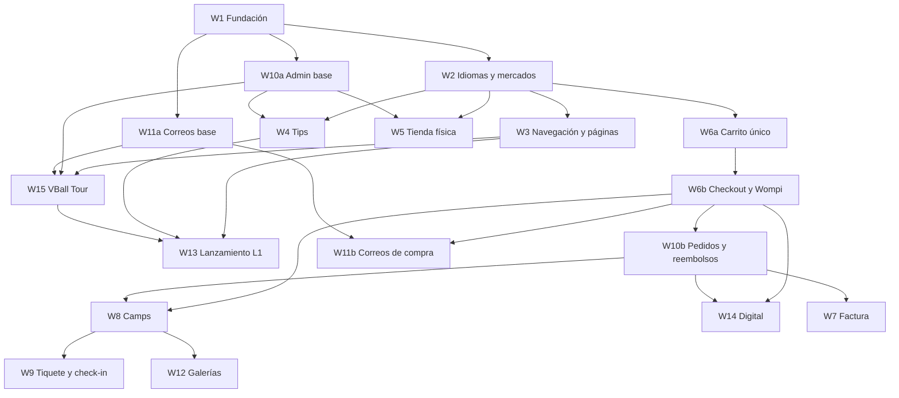

# Plan maestro — VolleyTip.com

Rediseño completo de volleytip.com: sitio público, tienda (física y digital), camps, VBall Tour y admin.
Fuente: `docs/SRD-volleytip-web-v1.4.md`. Modelo de datos: `docs/modelo-de-datos.md`.
Fecha: 11 de noviembre de 2026.

Cada epic es un issue de GitHub con label `epic`. Sus tickets ejecutables se crean como sub-issues al aprobar el PRD del epic (`docs/prd/<epic>.md`, escrito con `/write-prd`). Los epics no son elegibles para la cola de la fábrica: solo sus tickets lo son, y solo los que salieron de `/write-prd` reciben `ready-for-dev`.

## Cómo leer este plan

- Los epics conservan el nombre del SRD (W1 a W15) para que la trazabilidad no se rompa. Tres se parten en dos (W6, W10 y W11) porque una parte se necesita antes que la otra.
- **Lanzamiento** es un corte que se publica en volleytip.com. Hay cuatro, y cada uno deja el sitio funcionando completo con lo que tenga hasta ahí.
- **Tamaño** es relativo: S (pocos tickets), M, L (el epic más grande del plan es L). No son fechas.
- **Revisión humana** marca los epics donde ningún ticket se aprueba solo con las pruebas en verde. "Sí (RLS)" significa que la revisión cae solo sobre los tickets que crean o cambian tablas, no sobre el epic entero (sección "Áreas de revisión humana obligatoria").

## Lanzamientos

| Lanzamiento      | Qué se publica                                                                                                                        | Epics                                | Por qué en este orden                                                                                                 |
| ---------------- | ------------------------------------------------------------------------------------------------------------------------------------- | ------------------------------------ | --------------------------------------------------------------------------------------------------------------------- |
| **L1 · Vitrina** | Sitio nuevo en volleytip.com: home, tips, nosotros, contacto, página de la app, VBall Tour, admin de contenido. Se apaga DigitalOcean | W1, W2, W3, W4, W10a, W11a, W15, W13 | Reemplaza la web actual cuanto antes y deja de pagar los servidores viejos. No depende de precios, envíos ni contador |
| **L2 · Tienda**  | Catálogo, producto, carrito único, checkout con Wompi, pedidos, envíos, reembolsos                                                    | W5, W6a, W6b, W10b, W11b             | Primera venta real. Deja construido el carrito y el pago que usan los demás                                           |
| **L3 · Camps**   | Listado y detalle de camps, inscripción desde el carrito, códigos de club, tiquete QR, ceder cupo, check-in, liquidación              | W8, W9                               | Reutiliza el carrito y el pago de L2. Tiene fecha real: debe estar antes del próximo camp                             |
| **L4 · Digital** | Productos digitales, "Mis compras", reproductor, descargables, combos                                                                 | W14                                  | Aún no existe ningún paquete (pendiente P-05). Es el epic con más piezas de seguridad                                 |
| Después          | Galerías descargables (W12), factura electrónica (W7), fase 2 del admin de celular, envíos por API                                    | W12, W7                              | Fase 2 y "a futuro" en el SRD                                                                                         |

Si hay un camp con fecha antes de terminar L2, L3 puede adelantarse a la tienda física: W6a, W6b y W10b son los únicos epics de L2 de los que depende, y W6a no necesita a W5 (se prueba con ítems sembrados en `catalog_items`). W5 (catálogo físico) puede esperar.

## Epics

| Epic                                          | Lanz.   | Alcance                                                                                                                                                                                                                                                                                                                                                                                                                                                                                            | FRs                                                          | Depende de                                                                                    | Tamaño | Revisión humana                                                |
| --------------------------------------------- | ------- | -------------------------------------------------------------------------------------------------------------------------------------------------------------------------------------------------------------------------------------------------------------------------------------------------------------------------------------------------------------------------------------------------------------------------------------------------------------------------------------------------- | ------------------------------------------------------------ | --------------------------------------------------------------------------------------------- | ------ | -------------------------------------------------------------- |
| **W1** · Fundación técnica y entornos         | L1      | Lo que el bootstrap del repo no deja hecho: componentes base del lienzo sobre los tokens de `design-system.md`, dos proyectos de Supabase, esquema base (perfiles, ajustes, bitácora, límites), RLS por defecto, tipos generados y su chequeo en el CI, despliegue a Railway (pruebas y producción), Bunny Optimizer, utilidades de formularios protegidos (FR-135). El bootstrap ya entrega el repo, React Router 8 + Tailwind 4, los tokens de marca, y lint, tipos y pruebas corriendo en el CI | FR-070, FR-076, FR-077, FR-123, FR-124, FR-135               | —                                                                                             | L      | Sí (RLS y secretos). **Se hace acompañado, no con la fábrica** |
| **W2** · Idiomas, mercados y monedas          | L1      | Rutas sin prefijo y `/en/`, archivos de traducción, prueba que impide texto sin traducir, contenido por idioma con respaldo en español, mercados, precios por mercado fijados a mano, precio aproximado en dólares con tasa manual                                                                                                                                                                                                                                                                 | FR-004–FR-011, FR-122                                        | W1                                                                                            | M      | Sí (RLS)                                                       |
| **W3** · Navegación, home y páginas de apoyo  | L1      | Barra de anuncios, header con menú único, pie, home, nosotros, contacto, página de la app con lista de espera, preguntas frecuentes, Términos y Privacidad, páginas de error 404 y 500, modo mantenimiento, ruta `/r/` reservada, archivos `.well-known`                                                                                                                                                                                                                                           | FR-001–FR-003, FR-012, FR-052–FR-057, FR-080–FR-082, FR-137  | W2                                                                                            | M      | Sí (RLS)                                                       |
| **W4** · Tips                                 | L1      | Listado con filtros y búsqueda, detalle con reproductor de Bunny, compartir, relacionados, importación de videos existentes, vista de solo lectura para la app                                                                                                                                                                                                                                                                                                                                     | FR-013–FR-017, FR-078                                        | W2, W10a                                                                                      | M      | Sí (RLS)                                                       |
| **W10a** · Admin base                         | L1      | Login por enlace mágico o Google, roles, resumen, editor de tips, bandeja de mensajes, textos del sitio y preguntas frecuentes, idiomas y mercados, equipo, bitácora de auditoría, barra inferior en celular                                                                                                                                                                                                                                                                                       | FR-058–FR-060, FR-064–FR-067, FR-079                         | W1. La bandeja de mensajes y el editor de preguntas frecuentes esperan las tablas que crea W3 | L      | Sí (acceso al admin)                                           |
| **W11a** · Correos base                       | L1      | Resend con dominio verificado, plantilla común, registro y reintento de envíos, correos de respuesta a contacto y de acceso al admin                                                                                                                                                                                                                                                                                                                                                               | FR-068 (parte), FR-069                                       | W1                                                                                            | S      | Sí (RLS)                                                       |
| **W15** · VBall Tour                          | L1      | Página del Tour, paradas en el admin, registro de asistencia individual y de grupo con sus reglas, confirmación en pantalla y por correo si lo dejaron, formulario de aliados, contador                                                                                                                                                                                                                                                                                                            | FR-130–FR-134, FR-136                                        | W3, W10a, W11a                                                                                | M      | Sí (RLS)                                                       |
| **W13** · Lanzamiento y reemplazo             | L1      | Rescate de fotos de Strapi, `sitemap.xml` (NFR-008), lista de verificación, cambio de DNS, modo mantenimiento, apagado de DigitalOcean a los 30 días                                                                                                                                                                                                                                                                                                                                               | FR-071–FR-075                                                | Todo L1                                                                                       | S      | Sí (lista de verificación, lo hace Camilo)                     |
| **W5** · Tienda física y envíos               | L2      | Catálogo con filtros, producto con color y talla, inventario, insignias, "Avísame", relacionados, zonas de envío y tarifa, editor de productos en el admin, páginas de Envíos y de Cambios y devoluciones (FR-057, vienen de W3)                                                                                                                                                                                                                                                                   | FR-018–FR-021, FR-023, FR-061, FR-120                        | W2, W10a                                                                                      | L      | Sí (RLS)                                                       |
| **W6a** · Carrito único                       | L2      | Carrito para los tres tipos de ítem, sugerencias, guardado 30 días, casilla y recordatorio de carrito. Se construye y se prueba con ítems sembrados en `catalog_items`. Deja listo el punto donde W8 conecta el código de club                                                                                                                                                                                                                                                                     | FR-022, FR-095, FR-096, FR-101, FR-102                       | W2                                                                                            | M      | Sí (RLS)                                                       |
| **W6b** · Checkout y Wompi                    | L2      | Checkout en una página con las secciones que el carrito necesita, corrección y confirmación del correo, reservas de 30 minutos, pedido pendiente, widget de Wompi, webhook verificado e idempotente, estado de pago y estado de entrega, pedidos con pago pendiente que no expiran, conciliación diaria, datos y valores para factura, página de pago rechazado (FR-056, viene de W3)                                                                                                              | FR-024–FR-030, FR-098–FR-100, FR-107, FR-108, FR-125, FR-126 | W6a                                                                                           | L      | **Sí, todo el epic**                                           |
| **W10b** · Pedidos, reembolsos y reportes     | L2      | Pedidos en el admin, marcar enviado con guía, cambio de correo, reembolso total o por ítem, enlace a Wompi, exportar ventas, aviso de tope anual, interruptor de factura (apagado)                                                                                                                                                                                                                                                                                                                 | FR-062, FR-109, FR-113–FR-115, FR-127–FR-129                 | W6b                                                                                           | M      | Sí (reembolsos y cambio de correo)                             |
| **W11b** · Correos de compra                  | L2      | Pedido confirmado, pago en proceso, pedido enviado, reembolso confirmado, correo de la compra actualizado, recordatorio de carrito, volvió el stock                                                                                                                                                                                                                                                                                                                                                | FR-068 (parte)                                               | W6b, W11a                                                                                     | S      | No                                                             |
| **W8** · Camps e inscripción                  | L3      | Listado y detalle, planes y precios por camp, cupos atómicos, datos del jugador y del acudiente en el checkout, códigos de club por plan y su uso en el carrito, política de cancelación, liquidación del club, editor de camps en el admin, correo de aviso de nuevo camp                                                                                                                                                                                                                         | FR-035–FR-042, FR-063, FR-097, FR-116–FR-118                 | W6b, W10b                                                                                     | L      | Sí (cupos, datos de menores, liquidación)                      |
| **W9** · Tiquete, ceder cupo y check-in       | L3      | Tiquete con QR y PDF, "Mi tiquete", recuperar tiquete, ceder cupo con código al correo o sesión, enlaces de staff con PIN, escáner con búsqueda y modo sin conexión (lista de hashes), correos del camp                                                                                                                                                                                                                                                                                            | FR-043–FR-049, FR-119                                        | W8                                                                                            | L      | Sí (tokens, validación del tiquete y lo que ve el staff)       |
| **W14** · Productos digitales y "Mis compras" | L4      | Página de producto digital, admin de paquetes y lecciones, accesos por correo, entrada a "Mis compras" con código, reproductor con URLs firmadas, descargables con marca, límite de sesiones, combos, sugeridos                                                                                                                                                                                                                                                                                    | FR-083–FR-094, FR-103–FR-106, FR-110–FR-112, FR-121          | W6b, W10b                                                                                     | L      | **Sí, todo el epic**                                           |
| **W12** · Galerías                            | Después | Galería por camp pasado, descarga y ZIP                                                                                                                                                                                                                                                                                                                                                                                                                                                            | FR-050, FR-051                                               | W8                                                                                            | M      | Sí (RLS)                                                       |
| **W7** · Factura electrónica                  | Después | Conexión con el proveedor, notas crédito, alertas                                                                                                                                                                                                                                                                                                                                                                                                                                                  | FR-031–FR-034                                                | W10b y la respuesta del contador (P-13)                                                       | M      | Sí                                                             |

### Las tres particiones

- **W6 en W6a y W6b.** El carrito (W6a) no toca dinero y la fábrica lo puede construir sola. El checkout y Wompi (W6b) concentran el riesgo: se separan para que la revisión humana caiga sobre un epic pequeño y claro.
- **W10 en W10a y W10b.** El admin base (login, contenido, mensajes) se necesita en L1 para publicar tips. La parte de pedidos y reembolsos no existe hasta que hay pedidos. Además, cada epic de producto construye su propia sección del admin: W5 el editor de productos, W8 el de camps, W14 el de digitales, W15 el de paradas. W10 no es "todo el admin".
- **W11 en W11a y W11b.** Igual: la infraestructura de correo y los correos de L1 primero; cada epic posterior agrega sus plantillas (W9 los del camp, W14 los digitales, W15 los del Tour).

## Grafo de dependencias

## Carriles paralelos

La fábrica puede trabajar tickets de epics distintos a la vez si no tocan los mismos archivos ni la misma migración. Carriles sugeridos:

| Momento     | Carril A                               | Carril B                                                                         | Carril C                               |
| ----------- | -------------------------------------- | -------------------------------------------------------------------------------- | -------------------------------------- |
| Inicio      | W1 (acompañado, sin paralelismo)       | —                                                                                | —                                      |
| L1          | W2, luego W3                           | W10a, luego W4                                                                   | W11a, luego W15                        |
| L2          | W5                                     | W6a (con ítems sembrados)                                                        | W11b (plantillas con datos de ejemplo) |
| L2 (cierre) | W6b (un ticket a la vez, con revisión) | W10b, cuando W6b tenga pedidos reales en pruebas                                 | —                                      |
| L3          | W8                                     | W9 (pantallas de tiquete y escáner con datos sembrados; se conecta al cerrar W8) | —                                      |
| L4          | W14 lado comprador                     | W14 lado admin                                                                   | —                                      |

Regla para evitar choques: **las migraciones de base de datos van en un solo carril a la vez.** Si dos tickets abiertos necesitan migración, el segundo lleva `blocked-by-N`.

Dos cruces entre carriles de L1 que los tickets resuelven con `blocked-by-N`: la bandeja de mensajes y el editor de preguntas frecuentes de W10a esperan las tablas `messages` y `faqs`, que crea W3; y AC-021 de W3 (barra de anuncios editable) se comprueba cuando W10a tiene el editor de textos (FR-065).

## Racional del orden

1. **W1 primero y a mano.** El bootstrap del repo deja la cáscara sobre la que la fábrica se apoya (`stop-gate.sh` necesita lint, tipos y pruebas). W1 agrega la base de datos, los entornos y los secretos, que no se delegan.
2. **Idiomas antes que cualquier pantalla.** El SRD prohíbe texto escrito en los componentes (FR-006). Si W2 llega tarde, hay que reescribir cada pantalla.
3. **L1 sin ventas.** Lo que frena la venta son decisiones de negocio (precios, envíos, contador), no el código. La vitrina no depende de ninguna y permite apagar DigitalOcean.
4. **VBall Tour en L1.** No usa pagos, reutiliza el formulario de contacto y la bandeja de mensajes, y da una razón para visitar el sitio nuevo.
5. **Tienda antes que camps.** El carrito y el pago se prueban primero con el caso más simple (una camiseta). Los camps suman cupos, menores y tiquetes sobre algo ya probado. Excepción: si hay un camp con fecha, ver la nota de "Lanzamientos".
6. **Digital al final.** No hay paquetes todavía, y es donde un error expone contenido de pago. Llega cuando el pago, los correos y el admin ya llevan tiempo en producción.

## Decisiones técnicas transversales

Valen para todos los epics. Un PRD no las repite ni las contradice; si un epic necesita una excepción, el PRD lo dice de forma explícita.

### Estructura y stack

- Un solo repo. React Router 8 en modo framework (SSR; la 7 queda como respaldo si la 8 no funciona con Tailwind 4), TypeScript estricto, Tailwind 4. Hosting en Railway; nada exclusivo de Railway en el código (FR-124).
- Supabase es el único backend: Postgres con RLS, Auth, Edge Functions para webhooks y tareas programadas con `pg_cron`.
- Dos proyectos de Supabase en una misma organización (`volleytip-web`): `volleytip-dev` (pruebas y staging) y `volleytip-prod`. Las migraciones viven en el repo y las aplica el CI en cada merge a `main`, primero a pruebas y después a producción; nadie cambia el esquema a mano. Durante el desarrollo la organización está en el plan gratis, que pausa un proyecto tras cerca de una semana sin actividad y no hace copias diarias. Pasa a Pro antes del lanzamiento L1. (Decidido por Camilo el 17 de noviembre de 2026. El 11 de noviembre se había decidido Pro desde el inicio.)
- Tipos de Supabase generados en cada migración. El CI falla si están desactualizados.

### Datos

- Dinero: enteros en la unidad menor de la moneda más su código ISO 4217 (DR-001). Nunca decimales ni `float`.
- El correo normalizado (minúsculas, sin espacios) une pedidos, accesos y tiquetes (DR-008).
- Nada se borra: pedidos, inscripciones, accesos y facturas se anulan con estado (DR-006).
- Toda tabla tiene RLS activado y sin políticas por defecto: lo que no tiene política no es accesible desde el navegador.
- Las operaciones que no admiten carrera (reservar stock, cupos o cupos de código de club, confirmar un pago, validar un tiquete, ceder un cupo, registrar asistencia) son funciones de Postgres en una transacción con bloqueo de fila. El código de la aplicación no hace "leer y luego escribir" sobre esos datos.
- Lo vendible es un `catalog_item` (físico, digital, plan de camp o combo). El carrito, los precios y las líneas de pedido apuntan a él. Ver `docs/modelo-de-datos.md`.
- Un pedido tiene estado de pago y estado de entrega por separado (FR-029). Un reembolso no borra que el pedido ya se envió.
- Stock, cupos y cupos de código de club se retienen en un solo sitio: `reservations`. Una inscripción sin pagar no cuenta cupo por sí misma.
- El código de club se aplica por línea de pedido, no por pedido.
- La entrega de un pedido pagado se reparte por tipo de ítem dentro de `confirm_order_paid`. W8, W9 y W14 agregan su parte a esa función, y esos tickets llevan la misma revisión que W6b.

### Seguridad

- Ninguna llave secreta llega al navegador. La llave `service_role` solo vive en el servidor y en las Edge Functions.
- Los webhooks (Wompi, Bunny) se verifican por firma y se guardan con su identificador para que repetirlos no duplique nada (DR-005).
- El estado de un pago cambia solo por el evento verificado de Wompi, nunca por la página de regreso (FR-026).
- Tokens de tiquete, de enlaces privados y de staff: aleatorios de 32 bytes o más; los PIN se guardan con hash.
- Los archivos de pago nunca tienen URL pública permanente (FR-088).
- Bunny Stream usa dos librerías: una pública para los tips y otra con autenticación por token para las lecciones de pago.
- El escáner sin conexión descarga hashes de los tokens, nunca los tokens. El staff solo ve nombre del jugador, plan y camiseta (FR-048, FR-049).
- Ceder un cupo exige un código al correo del comprador o sesión en "Mis compras"; el enlace del tiquete solo no basta (FR-119).
- Todo formulario público pasa por la utilidad común de W1, que aplica las cinco capas de FR-135. Un formulario nuevo no implementa su propia protección.

### Idiomas y contenido

- Texto fijo: archivos de traducción por idioma. Una prueba del CI falla si hay texto visible sin clave o una clave sin traducción en inglés (AC-002).
- Contenido editable: tabla base más tabla `*_translations`; si falta la traducción, se muestra en español (FR-007).
- Fechas, números y monedas se formatean con `Intl` según el idioma.

### Interfaz

- Los mockups del lienzo son la referencia visual. Cada PRD nombra las pantallas que le corresponden (columna "Mockups" de la matriz del SRD).
- Tokens de marca y componentes base se definen una vez en W1 (`design-system.md`). Un epic no inventa colores, tamaños ni componentes nuevos sin agregarlos ahí.
- Celular primero: todo funciona desde 360 px. Accesibilidad WCAG 2.2 AA.
- Una pantalla sin mockup de celular se construye desde el mockup de computador y `design-system.md`. Donde un mockup contradice al SRD manda el SRD; las diferencias conocidas están en el pendiente P-24.
- Las imágenes pasan por Bunny Optimizer y reservan su espacio (FR-123).

### Interruptores

Tres comportamientos se prenden o apagan desde Ajustes, sin desplegar:

| Interruptor         | Estado inicial | Efecto                                                                       |
| ------------------- | -------------- | ---------------------------------------------------------------------------- |
| Modo mantenimiento  | Apagado        | Toda página pública muestra mantenimiento; el admin sigue accesible (FR-056) |
| Módulo de factura   | Apagado        | No se llama a ningún proveedor; los campos de factura quedan vacíos (FR-127) |
| Productos digitales | Automático     | La sección Digital aparece cuando hay al menos uno publicado (FR-121)        |

### Pruebas y definición de terminado

Un ticket está terminado cuando:

1. Pasa lint, tipos y pruebas en el CI.
2. Tiene pruebas de la lógica que el SRD señala: pagos, stock, cupos, accesos digitales y check-in (NFR-010).
3. Cumple los criterios de aceptación del SRD que el PRD le asignó, citados por su número (AC-0xx).
4. No tiene texto sin traducir.
5. Si tocó el esquema: migración incluida, RLS definido y tipos regenerados.
6. Si es de un área de revisión humana: aprobado por Camilo.

## Áreas de revisión humana obligatoria

En estas áreas la fábrica propone y una persona aprueba. Las pruebas en verde no bastan.

| Área                              | Epics                                                                                           | Qué se revisa                                                                                                                                  |
| --------------------------------- | ----------------------------------------------------------------------------------------------- | ---------------------------------------------------------------------------------------------------------------------------------------------- |
| Pagos                             | W6b, y cualquier ticket de W8, W9 o W14 que toque `create_pending_order` o `confirm_order_paid` | Firma de integridad, verificación del webhook, idempotencia, cambio de estados, conciliación                                                   |
| Reembolsos y cambio de correo     | W10b                                                                                            | Que revoquen accesos y tiquetes, que exijan verificación y comprobante, que queden en la bitácora                                              |
| Políticas RLS                     | W1 y todo epic que crea tablas: W2, W3, W4, W5, W6a, W6b, W8, W9, W10b, W11a, W12, W14 y W15    | Que ningún dato de compradores o de menores se lea sin sesión o con la sesión de otro. Aplica a los tickets con migración                      |
| Acceso al admin y a "Mis compras" | W10a, W14                                                                                       | Códigos de un solo uso, límites, cierre de sesión, que la pantalla no revele si un correo ha comprado                                          |
| Contenido de pago                 | W14                                                                                             | URLs firmadas, vencimientos, marca en los PDF, revocación                                                                                      |
| Cupos y tiquetes                  | W8, W9                                                                                          | Conteo atómico, cupos de código de club reservados, tiquete válido una vez por día, cesión que exige código o sesión e invalida el QR anterior |
| Datos de menores                  | W8, W9                                                                                          | Qué se guarda, quién lo ve (el staff de check-in no ve si el jugador es menor), retención (P-11)                                               |
| Lanzamiento                       | W13                                                                                             | La lista de verificación la ejecuta una persona                                                                                                |

## Pendientes que condicionan el plan

Del SRD, sección 16. Solo los que mueven un lanzamiento:

| Pendiente                                                                                                                            | Bloquea                                                              |
| ------------------------------------------------------------------------------------------------------------------------------------ | -------------------------------------------------------------------- |
| Pasar la organización de Supabase a Pro (decisión del 17 de noviembre de 2026)                                                       | L1 (W13)                                                             |
| P-18 · Confirmar el plan Hobby de Railway                                                                                            | L1 (W13)                                                             |
| Probar en Railway que un workflow en rojo no despliega y que una variable borrada conserva el despliegue anterior (pospuesto en #31) | L1 (W13)                                                             |
| P-15 · Textos legales                                                                                                                | L1 puede salir con borradores marcados; deben estar firmes en L2     |
| P-08 · Fundaciones que reciben donaciones                                                                                            | Publicar la primera parada del Tour (L1)                             |
| P-01 a P-04 · Precios, fotos, zonas de envío, plataforma de envíos, cambio de talla                                                  | L2                                                                   |
| P-10 y P-17 · Comisión en reembolsos y cómo reversa Wompi                                                                            | L2 (W10b)                                                            |
| P-13 · Consulta con el contador                                                                                                      | L2                                                                   |
| P-06 y P-16 · Datos de cada camp y retracto en camps                                                                                 | L3                                                                   |
| P-11 · Retención de datos de menores                                                                                                 | L3                                                                   |
| P-05, P-09 y P-14 · Primeros paquetes, reembolso digital e IVA digital                                                               | L4                                                                   |
| P-19 a P-24 · Mockups faltantes y correcciones a los existentes                                                                      | W14, W6b, W8, W15, W3 y W9. No bloquean: mientras tanto manda el SRD |
| P-26 y P-27 · Códigos y enlaces con Supabase Auth o propios                                                                          | W9 y W14                                                             |

## Trazabilidad

Cada FR del SRD pertenece a un solo epic. La matriz completa (FR, AC, historias y mockups por epic) está en la sección 15 del SRD. Diferencias de este plan frente a esa matriz:

- FR-135 (protección de formularios) pasa de W3 a W1, porque es una utilidad que usan W3, W10a y W15.
- FR-061 y FR-063 (editores de productos y de camps) pasan de W10 a W5 y W8.
- FR-103 y FR-104 (admin de digitales) ya estaban en W14; FR-105 y FR-106 se construyen también en W14.
- FR-068 (lista de correos) se reparte: la infraestructura en W11a y cada plantilla en el epic que la necesita.
- FR-097 (código de club en el carrito) pasa de W6 a W8, porque los códigos de club no existen antes. W6a deja el carrito listo para recibirlo.
- FR-137 (preguntas frecuentes) es nuevo en la v1.4 del SRD y va en W3.

## Estado

El repo y la fábrica quedan instalados con el bootstrap. El PRD de W1 (`docs/prd/w1-fundacion-tecnica.md`) quedó aprobado el 17 de noviembre de 2026 y sus 17 tickets están creados (#20 a #36). Siguiente paso: trabajar el #20 y el #23, que son acompañados.

| Epic                                              | Issue | Estado                                                                                                                                                                     |
| ------------------------------------------------- | ----- | -------------------------------------------------------------------------------------------------------------------------------------------------------------------------- |
| W1 · Fundación técnica y entornos                 | #1    | Cerrada el 21 de noviembre de 2026: tickets #20 a #36                                                                                                                      |
| W2 · Idiomas, mercados y monedas                  | #2    | PRD aprobado: `docs/prd/w2-idiomas-mercados-monedas.md`. Tickets #59 a #68 creados                                                                                         |
| W3 · Navegación, home y páginas de apoyo          | #3    | Sin empezar                                                                                                                                                                |
| W4 · Tips                                         | #4    | Sin empezar                                                                                                                                                                |
| W10a · Admin base                                 | #5    | Sin empezar                                                                                                                                                                |
| W11a · Correos base                               | #6    | Sin empezar                                                                                                                                                                |
| W15 · VBall Tour                                  | #7    | Sin empezar                                                                                                                                                                |
| W13 · Lanzamiento y reemplazo                     | #8    | Sin empezar                                                                                                                                                                |
| W5 · Tienda física y envíos                       | #9    | Sin empezar                                                                                                                                                                |
| W6a · Carrito único                               | #10   | Sin empezar                                                                                                                                                                |
| W6b · Checkout y Wompi                            | #11   | Sin empezar                                                                                                                                                                |
| W10b · Pedidos, reembolsos y reportes             | #12   | Sin empezar                                                                                                                                                                |
| W11b · Correos de compra                          | #13   | Sin empezar                                                                                                                                                                |
| W8 · Camps e inscripción                          | #14   | Sin empezar                                                                                                                                                                |
| W9 · Tiquete, ceder cupo y check-in               | #15   | Sin empezar                                                                                                                                                                |
| W14 · Productos digitales y "Mis compras"         | #16   | Sin empezar                                                                                                                                                                |
| W12 · Galerías                                    | #17   | Sin empezar                                                                                                                                                                |
| W7 · Factura electrónica                          | #18   | Sin empezar                                                                                                                                                                |
| Fábrica y tooling (**agregada después del plan**) | #19   | Abierta de forma permanente. No tiene alcance de producto ni lanzamiento: de ella cuelgan los incidentes del kit de la fábrica y de main roto (`scripts/file-incident.sh`) |
